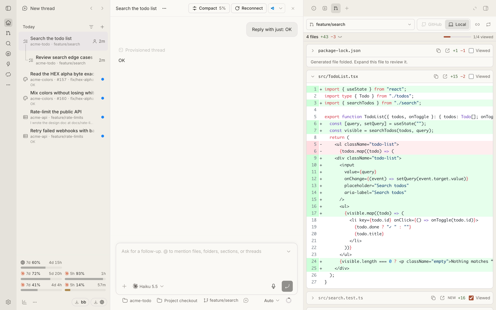

# bb-plugins

Plugins for [bb](https://getbb.app), the agentic IDE. Each one lives in its own
folder under `plugins/` and installs on its own.



<sub>A demo project; no real chats or code.</sub>

| Plugin | What it does |
| --- | --- |
| [Omgovich Sidebar](plugins/cursor-sidebar) | A replacement for bb's thread list. Each thread shows its project icon, PR and branch, a live line of what the agent is doing, and whether it is working or unread; child threads nest under their parent |
| [Omgovich PR Linker](plugins/pr-link) | Remembers which pull request each thread is about. It finds the PR from the thread's branch, or you attach one by hand when the branch does not tell (a review thread, someone else's PR). Sidebar, Diffs and PR Review show that PR |
| [Omgovich PR Peek](plugins/pr-peek) | Hover a link to a GitHub PR anywhere in bb and see its title, state, author and size in a tooltip |
| [Omgovich Diffs](plugins/pr-stack-diff) | A PR Diffs tab beside the thread for reviewing the agent's work: every PR of a stack, each against its parent, with Viewed marks and line comments sent back to the agent |
| [Omgovich PR Review](plugins/review-pr) | Paste a PR link and get a new thread that checks the PR out in its own worktree and has an agent review it |
| [Omgovich Usage Bars](plugins/usage-bars) | How much of your Claude and Codex limits is left, as bars at the bottom of the sidebar |
| [Omgovich Reconnect Agent](plugins/restart-session) | A Reconnect button in the thread header: restarts the agent's process without losing the conversation, so MCP tools come back after you re-authorize a server |

Sidebar, Diffs and PR Review show the thread's PR through PR Linker;
install it alongside them.

## Install

Add the collection to bb once, as a plugin marketplace:

```sh
bb marketplace add git:github.com/omgovich/bb-plugins@main
```

The plugins then show up in bb's plugin store (Settings → Plugins, or
`bb plugin search omgovich`) and install by id:

```sh
bb plugin install pr-link@omgovich
bb plugin install cursor-sidebar@omgovich
```

| Plugin | Id |
| --- | --- |
| Omgovich Sidebar | `cursor-sidebar` |
| Omgovich PR Linker | `pr-link` |
| Omgovich PR Peek | `pr-peek` |
| Omgovich Diffs | `pr-stack-diff` |
| Omgovich PR Review | `review-pr` |
| Omgovich Usage Bars | `usage-bars` |
| Omgovich Reconnect Agent | `restart-session` |

Each one tracks `main`: `bb plugin outdated` shows new commits and
`bb plugin update <id>` applies them. bb builds a plugin on install.

Without the marketplace, install straight from git:

```sh
bb plugin install git:github.com/omgovich/bb-plugins@main --plugin pr-link
```

PR Linker, PR Peek, Diffs and PR Review call the GitHub CLI, so `gh` must be installed
and logged in on the machine that runs bb.

## Limits

- PR Linker, Diffs and PR Review run `git` and `gh` on the machine that runs
  the bb server. Chats whose worktree lives on another enrolled machine show no
  PR there, and PR Review needs the project checked out on the server's machine.
- They read the GitHub repo from the worktree's `origin` remote on
  `github.com`; other hosts and remotes are not looked at.

## Develop

See [AGENTS.md](AGENTS.md).

## License

MIT. Omgovich Sidebar adapts code from
[bb-plugin-cursor-sidebar](https://github.com/wy3z/bb-plugin-cursor-sidebar);
see its [notices](plugins/cursor-sidebar/THIRD-PARTY-NOTICES.md).
