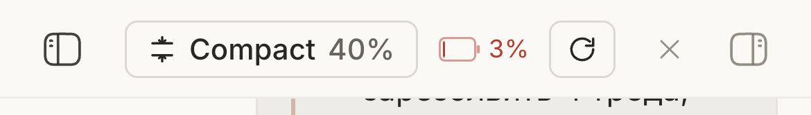

# Omgovich Host Battery

When you watch your agents from a phone, you cannot see the menu bar of the
Mac they run on, and they stop when its battery does. This plugin puts that
Mac's charge in the thread header on phones.

## What you get

- A battery with the percentage next to the other header buttons, on screens
  narrower than 640px. On a computer it stays hidden.
- A bolt while the Mac is on power. Amber at 20% or less and red at 10% or
  less while it runs on battery.
- Tap or hover for the details: charging and time to full, or time left on
  battery.

## How it works

The bb server reads `pmset -g batt` once a minute, and again when you come
back to the app. It shows nothing on a Mac without a battery or on another OS.
