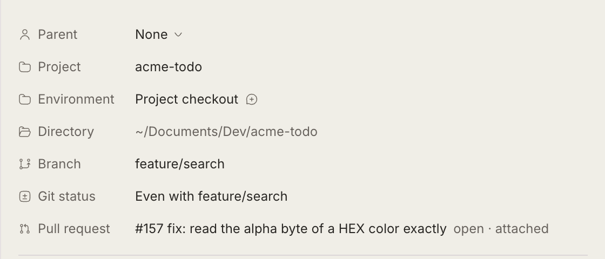
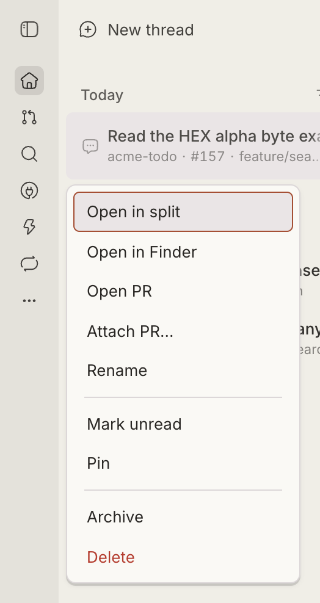

# Omgovich PR Linker

Remembers which pull request each thread is about, so every place that shows
a thread's PR shows the same, right one.

By default that is the PR of the thread's current branch, looked up with
`gh pr list --head <branch>`. When the branch does not tell — a review thread
on a local `review/pr-123` copy, a thread that helps with someone else's PR,
a branch with no PR yet — attach the PR by hand: from the sidebar's row menu
(**Attach PR…**), by picking it in the Diffs tab, or with `bb pr-link attach`.
An attached PR stays until you detach it.

bb's own PR status only ever looks at the branch, so in those cases it shows
nothing. Omgovich Sidebar, Diffs and PR Review read the PR from here instead.

## What you get

- A **Pull request** row in the thread's Info tab, marked "attached" when set by hand.
- `bb pr-link show <thread-id>`, `bb pr-link attach <thread-id> <PR URL or number>`,
  `bb pr-link detach <thread-id>`.
- An RPC other plugins read with `experimental_useRpcKeyedQuery`
  (`pluginId: "pr-link"`, method `pullRequests`, keys = thread ids). Every
  change invalidates `thread:<id>`, so readers refresh on their own.

Omgovich Sidebar, Diffs and PR Review use it.

  
  

## Requirements

`gh`, logged in, on the machine that runs bb. GitHub is asked at most every 90
seconds per branch or attached PR; chats viewed in the last 10 minutes are
re-checked every minute, so a branch switch shows up without a reload.
