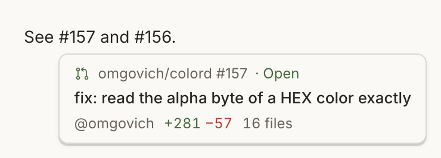

# Omgovich PR Peek

Hover a link to a GitHub pull request anywhere in bb — an agent's reply, a
README, a plan — and a tooltip shows what it is without leaving the thread.

## What you get

- Repository and number, state (open, draft, merged, closed), title, author,
  and the size of the change.
- Works for any link to `github.com/<owner>/<repo>/pull/<n>`, including links
  to a PR's files, commits or a comment. Links written as a bare `#123` with
  the URL behind them are covered too.
- Opens after a short hover or on keyboard focus; Escape or scrolling closes it.

## How it works

The plugin asks `gh pr view` about the PR and caches the answer for five
minutes, so hovering the same link again is instant.

## Requirements

`gh`, logged in, on the machine that runs bb. Private repositories need access
through that session; otherwise the tooltip says why it could not load.
