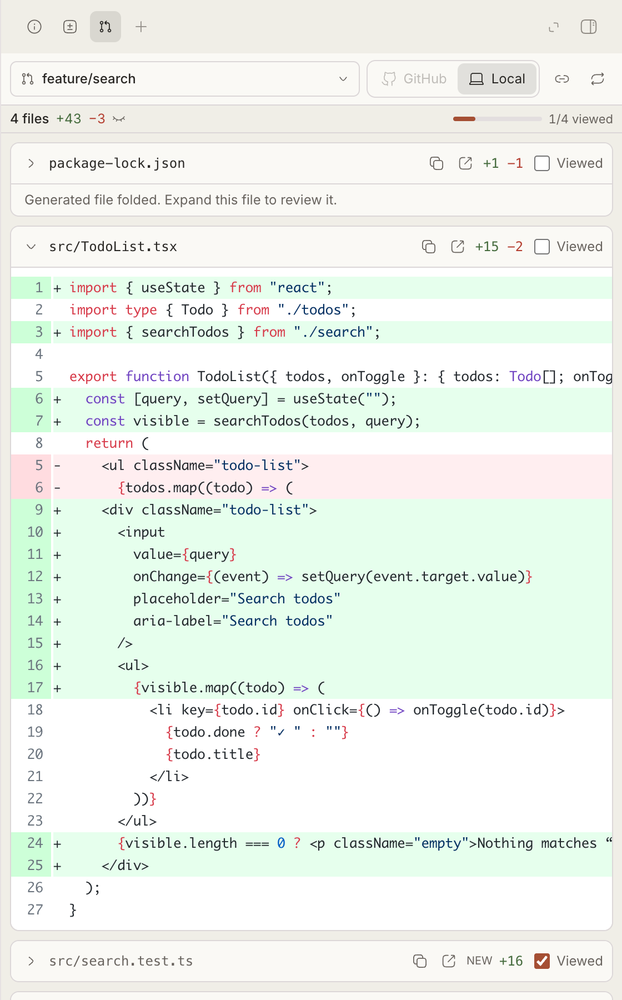

# Omgovich Diffs

A **PR Diffs** tab in the thread's side panel for reviewing every pull request
of the chat's stack (`gh stack` or any chain of PRs based on each other).

## What you get

- A picker with the whole stack, each PR diffed against its parent branch, not
  `main`. Picking a PR makes it the chat's PR through PR Linker.
- **GitHub** and **Local** diffs: what is pushed, or what is committed in the
  worktree. Only committed changes; whitespace-only edits are hidden.
- **Viewed** marks per file. A mark drops, and the file opens again, when the
  file's edits change. Test files (`*.test.*`, `__tests__/`, `tests/` and the
  like) count as viewed and start folded; lockfiles and generated files start
  folded.
- A **+** in the gutter opens a note that is sent to the chat's agent with the
  file, line and code.
- Copy path, open in your editor, open the PR on GitHub.

Long PRs stay light: a file's diff renders when it nears the viewport and is
dropped again far away, and diffs are cached by head commit.

## Requirements

[PR Linker](../pr-link) and `gh`, logged in, on the machine that runs bb.

## CLI

`bb pr-diff stack <thread-id>`, `bb pr-diff attach <thread-id> <PR>`,
`bb pr-diff detach <thread-id>`.
