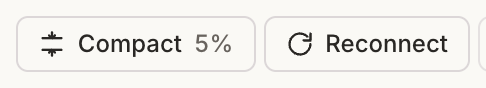

# Omgovich Reconnect Agent

A bb plugin that adds a **Reconnect** button to the thread header. It calls `threads.stop`, which
releases the agent runtime and keeps the thread. The next message starts a fresh agent process, so
MCP servers reconnect, for example after you re-authorized one.



```sh
npm install --include=dev
bb plugin install .
```
