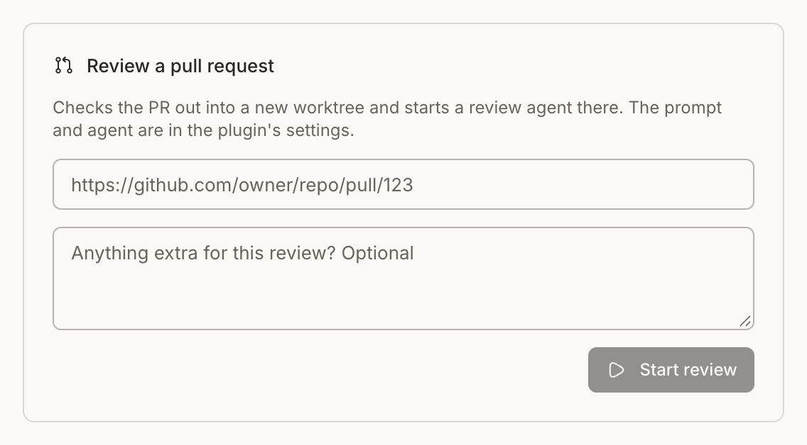

# Omgovich PR Review

Review a GitHub pull request in its own worktree thread.



## What you get

- A **Review PR** item in the sidebar navigation, under New thread. It opens a
  form for the PR URL and optional extra instructions.
- `bb review-pr start <url> [instructions...] [--json]` for terminals and agents.

## How it works

The plugin finds the bb project whose origin is the PR's repository, fetches
`pull/<n>/head` into the local branch `review/pr-<n>`, and starts a thread in a
new worktree from that branch. The thread is titled with the PR's title, lands
in the **Reviews** sidebar section, and is attached to the PR through
[PR Linker](../pr-link), so the sidebar and Diffs show the right PR even
though the worktree branch has none.

The thread gets the review prompt with the PR's URL, then your extra
instructions. By default the prompt points the agent at the bundled
`review-pull-request` skill: understand the change, look for real problems,
verify each one, report them ranked by severity. It never posts to GitHub on
its own.

## Settings

Settings → Installed plugins → Omgovich PR Review, or `bb plugin config review-pr`:

| Setting | Default | What it does |
| --- | --- | --- |
| `prompt` | Follow the bundled `review-pull-request` skill | The thread's first message; `{url}` becomes the PR's URL (appended if missing). Point it at your own skill, e.g. `/my-review {url}` |
| `providerId`, `model`, `reasoningLevel` | empty: the project's defaults | The review agent, e.g. `claude-code`, `claude-opus-5-5`, `high` |
| `permissionMode` | Project default | `auto`, `accept-edits` or `full` |
| `section` | `Reviews` | Sidebar section for review threads; empty for none |

```sh
bb plugin config review-pr set prompt "/my-review {url}"
bb plugin config review-pr set providerId codex
```

## Requirements

`gh`, logged in, and a bb project whose origin is the PR's repository.
