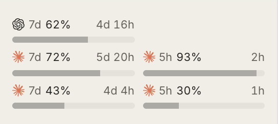

# Omgovich Usage Bars

Remaining Claude and Codex usage, as bars above the bb sidebar footer.

- One bar per provider you are logged in to, from bb's cached
  `system.usageLimits`: the weekly window, plus Claude's 5-hour window.
- Claude gets a third bar when the plan has a Fable-only weekly limit,
  labelled **Fable 7d**. Rows with three bars drop the reset time from the
  label; hover for it.
- A reading sometimes arrives without the Fable limit. If the plugin saw the
  limit before, the bar keeps the last reading, dimmed, with its time in the
  tooltip, for up to six hours or until the limit resets. Meanwhile the
  plugin reads again every 30 seconds, up to four times.
- With bb's Account Pooler on, one bar per pooled account instead, labelled
  with the account; the pool replaces the local login for the providers it
  serves.
- All percentages mean **remaining**. Yellow at 20% or less, red at 5% or
  less. Hover a bar for the time until reset and the exact reset date.

It refreshes every five minutes and when the window gets focus, from cached
measurements only: no credentials, no direct provider requests.

bb has no permanent slot for sidebar content, so the bars mount into
`[data-testid="app-sidebar-body"]`. A bb layout change may require updating
that selector.
